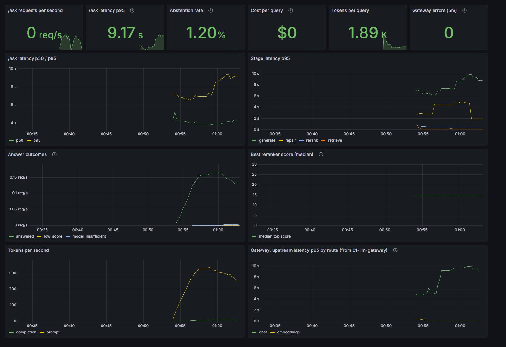
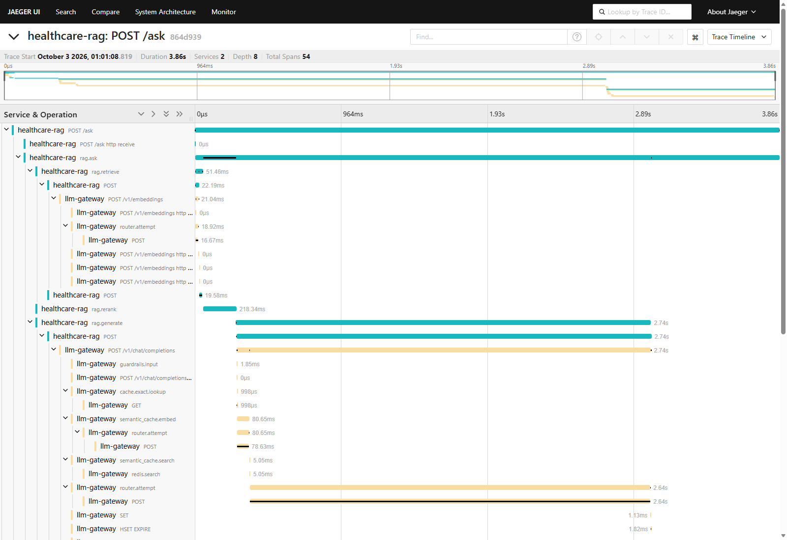

# Healthcare Research RAG over PubMed Central

Grounded question answering and summarization over PubMed Central Open Access literature. It uses hybrid retrieval (OpenSearch BM25 + Qdrant dense), reranking, and citation-required answers. All model inference goes through the [LLM Gateway](../01-llm-gateway/).

> Part of the Live Projects portfolio. See [SHARED_STANDARDS.md](../SHARED_STANDARDS.md) for conventions and the milestone definition of done.

## Overview

Researchers need answers they can check against the literature. This system ingests the
**PubMed Central Open Access** subset with PMCID normalization and deduplication, then
chunks articles by section. Retrieval is hybrid: BM25 in OpenSearch plus dense vectors in
Qdrant, followed by reranking. A LangGraph workflow produces **citation-required
answers**, and it abstains when the evidence is weak.

The service never calls a model provider directly. All chat and embedding calls go to
the **LLM Gateway (project 01)** through its OpenAI-compatible API, so routing, caching,
rate limits, and per-query cost and latency come from the gateway.

**Result:** on 92 held-out questions over 500 PMC articles, the system **improved answer
accuracy by 9.8 points (77.2% → 87.0%) and NDCG@10 by 24% (0.592 → 0.734) against the
BM25-only baseline**. It also declined all 14 out-of-scope test questions without an LLM
call, while keeping p95 latency at 7.6 s on a 20 W laptop GPU at $0 per query. A
cross-family LLM judge (kappa 0.83 against hand labels) rates 86.4% of its answers as
supported by the cited passages. Details, caveats and confidence intervals are in
[Evaluation & Results](#evaluation--results).

## Tech Stack

| Layer | Tools |
|---|---|
| API | FastAPI, Uvicorn |
| Orchestration | LangGraph (retrieve → rerank → gate → generate → verify → repair / abstain) |
| Sparse retrieval | OpenSearch 2.17 (BM25, English analyzer) |
| Dense retrieval | Qdrant 1.19 + `nomic-embed-text` embeddings via the gateway; RRF fusion |
| Reranking | `ncbi/MedCPT-Cross-Encoder` (PubMed-trained), fp16 on the GPU (`[rerank]` extra) |
| LLM inference | 01-llm-gateway (OpenAI-compatible) → Ollama `llama3.2` (3B) |
| Data | PubMed Central Open Access (CC BY/CC0) via NCBI E-utilities + BioC API |
| Observability | Prometheus, Grafana, OpenTelemetry → Jaeger (shared with the gateway) |
| CI | GitHub Actions: lint, tests, compose smoke test, integration tests, retrieval gate |

## Architecture

| Component | Responsibility |
|---|---|
| **Ingestion** (`ingest.py`) | Search PMC per topic, fetch BioC full text, keep CC BY/CC0, normalize PMCIDs, dedupe, chunk by section |
| **Indexers** (`bm25.py`, `dense.py`, `indexing.py`) | Idempotent upserts to OpenSearch and Qdrant, with payload/keyword fields for metadata filters |
| **Retriever** (`hybrid.py`) | BM25 and dense in parallel, fused with reciprocal rank fusion; filters on section, topic, PMCID, year |
| **Reranker** (`rerank.py`) | MedCPT cross-encoder over the top 20 candidates; its best score drives abstention |
| **LangGraph flow** (`rag.py`) | retrieve → rerank → gate (abstain if weak) → generate with numbered citations → verify → one citation-repair turn |
| **API** (`main.py`) | `/ask`, `/summarize`, `/health`, `/ready`, `/metrics` |
| **Gateway client** (`gateway.py`) | OpenAI-compatible client for all chat and embedding calls; reads token usage and `x-gateway-cost-usd` |
| **Evaluation** (`rag_eval.py`) | Retrieval and answer metrics vs the BM25 baseline, dev-tuned threshold, bootstrap CIs, report |

```
  NCBI E-utilities + BioC ──► ingest (CC BY/CC0, PMCID normalize, dedupe, section chunks)
                                     │                         │
                                     ▼                         ▼
                             OpenSearch (BM25)        Qdrant (nomic-embed-text)
                                     └────── RRF hybrid ───────┘
                                                 │ top 20
  client ──► FastAPI /ask ──► LangGraph: retrieve ─► MedCPT rerank ─► gate ──(weak)──► abstain
                 │                                                     │ top 5
                 │                                              generate ─► verify ─► answer + citations
                 │                                                     ▲        │ uncited: repair once
                 ▼                                                     │        ▼
       /metrics ─► Prometheus ─► Grafana      embeddings + chat ──► 01-llm-gateway ─► Ollama (GPU)
       OTel spans ─────────────────────────────► Jaeger ◄────────── (same trace)
```

## Setup

### Prerequisites
- Python 3.11
- **01-llm-gateway running**, on `http://127.0.0.1:8000` by default, with a client API
  key. Ollama needs `llama3.2` and `nomic-embed-text` pulled.
- Docker Desktop, for OpenSearch 2.17 and Qdrant 1.19 (`docker compose`). OpenSearch runs
  single-node with the security plugin disabled (local dev only) and a 512 MB heap. The
  search backends idle at about 1 GB of RAM.
- For reranking: `pip install -e ".[rerank]"`. On an NVIDIA GPU, install the CUDA build of
  torch first (see `pyproject.toml`). MedCPT used about 0.5 GB of VRAM next to `llama3.2`
  on a 6 GB card.
- Optional: GNU Make (see the Windows note below)

### Install
```bash
git clone <repo-url> 02-healthcare-rag && cd 02-healthcare-rag
py -3.11 -m venv .venv            # Windows; on macOS/Linux use: python3.11 -m venv .venv
source .venv/Scripts/activate     # Git Bash; PowerShell: .venv\Scripts\Activate.ps1; macOS/Linux: source .venv/bin/activate
make install                      # = pip install -e ".[dev]"
```

### Environment config
```bash
cp .env.example .env              # then fill in values; .env is git-ignored
```
Set `GATEWAY_BASE_URL` and `GATEWAY_API_KEY` to match the gateway. `GATEWAY_API_KEY`
must be one of the gateway's `GATEWAY_API_KEYS`. Set `OPENSEARCH_URL` and `QDRANT_URL`
to your local services. NCBI settings are optional but are good etiquette for bulk
downloads.

### Data: PubMed Central Open Access
`make ingest` (= `python -m healthcare_rag.ingest all --per-topic 50`) builds the corpus:

1. **Search:** NCBI E-utilities searches PMC for each of 10 clinical topics: type 2
   diabetes, hypertension, heart failure, atrial fibrillation, stroke, asthma, sepsis,
   tuberculosis, major depressive disorder and osteoporosis. Searches are by title,
   limited to the `"open access"[filter]`, published 2016–2023.
2. **Download:** full text comes from the NCBI BioC API, which labels each passage with
   its section. Only **CC BY / CC0** articles are kept (NC/ND licenses are skipped).
   PMCIDs are normalized (`123`, `pmc123` and `PMC0123` all become `PMC123`) and
   deduplicated across topics.
3. **Chunk:** chunks are section-aware (abstract, introduction, methods, results,
   discussion, conclusion). Paragraphs are packed to about 220 words (max 320) and never
   cross a section boundary. References, tables, figures and front matter are dropped,
   and passages that are exact duplicates anywhere in the corpus are removed.
4. **Index:** chunks are upserted into OpenSearch (BM25, English analyzer) keyed by
   `PMCID:position`. They are embedded with `nomic-embed-text` **through the gateway**
   and upserted into Qdrant under a deterministic UUID. Re-running embeds only chunks
   Qdrant doesn't have yet.

Raw files and chunks live under `DATA_DIR` (git-ignored). The PMCIDs, topics, years,
journals and licenses are recorded in [eval/pmc_manifest.json](eval/pmc_manifest.json),
so the exact corpus can be rebuilt.

**Current corpus (built 2026-10-03):** 500 articles (50 per topic), 8,369 chunks, and 3
duplicate chunks dropped. Indexing measured on the laptop described below, on AC power:
- BM25 upsert: 17 s.
- Embedding: 163 s (51 chunks/s, 2.95 M tokens, $0 on the local backend).
- A second run embedded 0 chunks and left both counts unchanged. The counts also
  survived a container restart.

## How to Run

> **Windows note:** `make` isn't installed on Windows by default. Install it with `choco install make`, or run the
> targets from **Git Bash**. You can also run the commands in the `Makefile` yourself
> (for example, `python -m pytest` instead of `make test`).

### Run everything in Docker
```bash
docker compose up -d --build          # API :8010, OpenSearch :9200, Qdrant :6333, Prometheus :9091, Grafana :3001
curl 127.0.0.1:8010/health            # liveness
curl 127.0.0.1:8010/ready             # 200 when OpenSearch and Qdrant are reachable, else 503
docker compose down                   # = make down (add -v to drop the indexes)
```
The app container reaches the gateway on the host through `host.docker.internal:8000`
(override with `GATEWAY_BASE_URL_DOCKER`). `/ready` reports the gateway's status but does
not require it. The image has no torch, so the container runs hybrid retrieval without the
reranker; run the API on the host for the full system. `make up-stack` also starts
01-llm-gateway's compose stack from `../01-llm-gateway`.

### Run the API on the host
```bash
# 1. Start the LLM Gateway (in ../01-llm-gateway): make run
make up                               # 2. OpenSearch + Qdrant in Docker
make ingest                           # 3. Download, chunk, embed and index 500 PMC articles
make dev                              # 4. API on http://127.0.0.1:8010 with auto-reload
```

### Reproduce the evaluation and the demo
```bash
make eval HARDWARE="<machine, GPU, power state>"   # retrieval + tuning + answers + docs/evaluation_report.md
python scripts/demo.py --markdown docs/demo.md     # scripted walkthrough of every endpoint
```
Check that a laptop is on AC power before measuring. `make eval` took about 1 hour on the
20 W laptop GPU.

### Run the M1 baseline
```bash
# Needs `make up` and the gateway on :8000, with GATEWAY_API_KEY set in .env
make eval-baseline HARDWARE="<your machine and power state>"
# = index eval/toy/corpus.json into OpenSearch, answer eval/toy/questions.json,
#   write eval/results/baseline_bm25.json (git-ignored) and docs/baseline_results.md
```

### Try it
```bash
# Ask a question. Optional filters: sections, topics, pmcids, year_min, year_max
curl -X POST http://127.0.0.1:8010/ask -H "Content-Type: application/json" \
  -d '{"question": "Why do some patients on lisinopril get a dry cough?"}'

# Summarize one indexed article
curl -X POST http://127.0.0.1:8010/summarize -H "Content-Type: application/json" \
  -d '{"pmcid": "PMC1234567"}'
```
`/ask` returns the answer, numbered citations (PMCID, section, link and snippet), per-stage
timings and token usage and cost. If the evidence is weak, it abstains with a fixed message
and a `reason`:
- `no_hits`: nothing was retrieved.
- `low_score`: the best reranker score is below `ABSTAIN_THRESHOLD`.
- `model_insufficient`: the model replied that the passages don't contain the answer.
- `uncited`: the answer cited none of the passages it was given.

To try it on the toy corpus before ingesting PMC (M3):
```bash
make index-toy && OPENSEARCH_INDEX=toy_chunks make dev
```

### Observability
- **Metrics:** `GET /metrics` (Prometheus). It exposes request latency by endpoint,
  latency per RAG stage (retrieve / rerank / generate / repair), answer outcomes
  (answered or the abstention reason), tokens, gateway-reported cost, citations per
  answer and the best reranker score.
- **Dashboard:** `docker compose up` also starts Prometheus on **:9091** and Grafana on
  **:3001**, with the *Healthcare RAG* dashboard provisioned (anonymous view). The ports
  differ from project 01's Prometheus/Grafana so both stacks can run side by side.
  Prometheus scrapes the API in compose, the API on the host (`make dev`), and the
  gateway's `/metrics`. That lets the dashboard put per-query cost and latency next to the
  gateway's upstream latency.
- **Traces:** set `OTEL_EXPORTER_OTLP_ENDPOINT=http://127.0.0.1:4318` to export to
  project 01's Jaeger (UI on :16686). The API creates a span per RAG stage, and its httpx
  calls carry `traceparent`. One trace therefore covers `/ask`, the embedding call, the
  rerank, and the generation inside the gateway (guardrails, cache, router, Ollama).
- **Alerts:** written down in [deploy/prometheus/alerts.yml](deploy/prometheus/alerts.yml)
  and evaluated by Prometheus:

  | Alert | Fires when |
  |---|---|
  | AskLatencyHigh | `/ask` p95 > 10 s for 5 min (measured test p95: 7.6 s) |
  | AbstentionRateHigh | more than 50% of `/ask` requests abstain over 15 min |
  | UncitedAnswersHigh | more than 20% of answers are dropped for missing citations over 15 min |
  | BackendErrors | more than 5 gateway or search failures in 5 min |



*The dashboard during a live run of 94 `/ask` requests (dev questions, then 40 test
questions) against the full system.*



*One `/ask` trace in Jaeger, 54 spans over 2 services: retrieve (with the embedding call
through the gateway), rerank, then generation inside the gateway.*

### Lint and test
```bash
make lint     # ruff check + ruff format --check
make test     # pytest: 122 unit tests, no Docker or network needed
make coverage # the same with line coverage (63%; fails below 60%)
make test-integration  # tests marked `integration` (needs `make up`)
make format   # auto-fix lint and formatting
```

## Evaluation & Results

**Headline (measured 2026-10-03, test split):** Against the BM25-only baseline, the full
system raised **NDCG@10 from 0.592 to 0.734 (+24%)** and **answer accuracy from 77.2% to
87.0% (+9.8 points)** on 92 held-out PubMed Central questions. Over the same test set it
declined **14 of 14** out-of-scope questions. End-to-end p95 latency was 7.6 s on a laptop
GPU held to 20 W.

### Method
- **Corpus:** 500 CC BY/CC0 PMC OA articles, 8,369 chunks (see *Data* above).
- **Questions:** 159 in [eval/qa/questions.json](eval/qa/questions.json).
  - 139 are answerable: one passage per article, sampled with a fixed seed from results,
    abstract, discussion and conclusion sections
    ([scripts/sample_qa_passages.py](scripts/sample_qa_passages.py)). Claude wrote each
    question and its reference answer keywords from that passage, paraphrasing rather
    than copying wording. That source chunk is the relevant chunk.
  - 20 are out of scope: medical questions the corpus does not cover.
  - The questions and labels were written by Claude (an AI), not by clinicians.
- **Split:** dev = every third question (53). Dev was used only to pick the abstention
  threshold and rerank depth, and to decide on citation repair. Test = 106 questions (92
  answerable, 14 out of scope); all numbers below are on test.
- **Baseline:** the M1 control: BM25-only retrieval (OpenSearch), top 3 passages, one
  gateway call, no reranking, no abstention logic.
- **Full system:**
  1. hybrid retrieval (BM25 + `nomic-embed-text` dense, RRF), top 20
  2. MedCPT cross-encoder rerank, keep top 5
  3. abstain if the best rerank score is below 6.43 (tuned on dev)
  4. `llama3.2` (3B) via the gateway, with numbered citations
  5. verify: drop uncited answers, after one citation-repair turn
- **Reproduce:** `make eval HARDWARE="..."` writes
  [docs/evaluation_report.md](docs/evaluation_report.md).

### Retrieval (test, 92 answerable questions; relevance = the source chunk)

| System | Recall@1 | Recall@5 | Recall@10 | MRR@10 | NDCG@10 | p50 / p95 latency |
|---|---|---|---|---|---|---|
| **BM25 (baseline)** | 0.380 | 0.717 | 0.848 | 0.512 | 0.592 | 12 / 21 ms |
| Dense (nomic-embed-text) | 0.293 | 0.739 | 0.870 | 0.484 | 0.577 | 47 / 59 ms |
| Hybrid (RRF) | 0.380 | 0.728 | 0.913 | 0.530 | 0.620 | 44 / 61 ms |
| **Hybrid + MedCPT rerank (top 20)** | **0.489** | **0.891** | **0.978** | **0.656** | **0.734** | 302 / 346 ms |

NDCG@10 gain over BM25: +0.143 (95% paired bootstrap CI +0.082 to +0.211). Reranking the
top 50 instead of 20 gave no gain on dev at 2.4× the rerank latency.

### Answers (test)

| Metric | BM25 baseline (M1) | Full system |
|---|---|---|
| Answer accuracy, answerable (keyword match; abstain counts as wrong) | 77.2% | **87.0%** |
| Answered rate, answerable | 85.9% | 95.7% |
| Cites the source chunk (when answered) | 53.2% | 63.6% |
| Cites the source article (when answered) | 96.2% | 98.9% |
| Answers with at least one valid citation | 96.2% | 100% |
| Out-of-scope questions declined | 14/14 | 14/14 |
| Abstention precision | 51.9% | 77.8% |
| End-to-end latency p50 / p95 | 2.7 s / 3.7 s | 4.1 s / 7.6 s |
| Mean prompt / completion tokens | 1,175 / 31 | 1,689 / 50 |
| Cost per query (gateway-reported) | $0 | $0 |

- **Statistical strength:** answer accuracy +9.8 points, 95% paired bootstrap CI +0.0 to
  +19.6. The gain is real on this set but at the edge of significance with N = 92.
- **How out-of-scope questions are declined:** the full system declines them **without
  calling the LLM** (rerank score gate). The baseline needs a generation call to say it
  doesn't know.
- **Citation repair:** the first measured run (v1) discarded uncited answers, which gave
  81.5% accuracy for the full system. Dev showed that every discarded answer was
  otherwise correct, so v2 adds one follow-up turn asking for citations. Both runs are in
  the report.
- **Faithfulness (measured 2026-10-19):** a second-pass judge from another model family,
  `qwen2.5:7b-instruct`, agreed with 20 hand labels 95% of the time (Cohen's kappa 0.83).
  The 3B generator judging itself managed only 0.65 (kappa 0.30), and an NLI cross-encoder
  0.30. By that judge, **86.4%** of the full system's answers are supported by their
  passages (95% CI 77.7-92.0, n = 88), against 81.0% for the BM25 baseline. That is short
  of the >90% target, so the target is **not met**. Details and raw outputs:
  [docs/benchmarks/2026-10-19-faithfulness](docs/benchmarks/2026-10-19-faithfulness/README.md).
- **Keyword grading, checked:** the same judge graded correctness, and the 27 answers where
  it and the keywords disagree were read by hand. Keywords were right in 17 and the judge in
  6 (4 unclear). Corrected accuracy is **82.6%** for the full system and 75.0% for the
  baseline (+7.6 points), so the keyword figure above overstates the full system by about
  4 points.
- **Cost:** $0, because the gateway prices the local Ollama backend at zero. Token counts
  are logged for pricing a hosted backend.
- **Hardware:** Acer Nitro V 15 (i5-13420H, RTX 4050 Laptop 6 GB) on AC power over
  USB-C, with the GPU held to **20 W**. Ollama, the embedder and the reranker share that
  GPU, and requests run one at a time.

### PubMedQA (external benchmark, measured 2026-10-03)

The same pipeline on the 500 expert-labelled PQA-L test questions (`make pubmedqa`), with
the 1,000 PQA-L abstracts, minus their conclusions, indexed separately. Answers must start
with yes, no or maybe.

| | Oracle abstract only | M1 baseline | Full system |
|---|---|---|---|
| Accuracy | 61.4% | 61.8% | 61.8% |
| Macro-F1 | 0.410 | 0.424 | 0.419 |
| Gold abstract in the passages shown | 100% | 98.6% | 99.6% |
| Latency p50 / p95 | 2.6 s / 3.8 s | 3.2 s / 4.6 s | 4.3 s / 7.5 s |

Retrieval is not the bottleneck here: the gold abstract is almost always shown, and even
the oracle that is handed it scores 61.4%. The limit is the 3B generator's yes/no/maybe
reasoning (it never says "maybe" in the full system), so the full system's +0.0 points
over the baseline (95% CI -3.2 to +3.2) is expected. Full table:
[docs/pubmedqa_results.md](docs/pubmedqa_results.md).

### M1 baseline: BM25-only + one gateway call (measured 2026-10-03)

**What it is:** the control that later pipelines are compared against. The question is sent
as a BM25 query to OpenSearch (English analyzer, `title` + `text`). The top 3 passages go
into one chat call to `llama3.2` (3B) through the LLM Gateway, at temperature 0 with the
gateway cache bypassed. There is no reranking, no dense retrieval and no abstention logic.

**Data:** a self-written toy corpus of **24 short passages** on common clinical topics
(`eval/toy/corpus.json`) and **24 questions** (`eval/toy/questions.json`). Each question
has one relevant passage and a reference answer, given as keyword groups. An answer counts
as correct when every keyword group appears as a whole term in it.

**Setup:** Acer Nitro V 15 (i5-13420H, RTX 4050 Laptop GPU 6 GB) on AC power over USB-C,
so the GPU is held to a **20 W power limit** (60 W default), as in project 01. Ollama 0.35.0
runs natively on the GPU, the gateway on the host, and OpenSearch 2.17.1 in Docker Desktop
with a 512 MB heap. Requests are sequential, after one warm-up request. Latency is client-side
wall-clock time.

| Metric (N = 24) | Run 1 | Run 2 |
|---|---|---|
| Recall@1 / Recall@3 / Recall@5 | 1.000 / 1.000 / 1.000 | 1.000 / 1.000 / 1.000 |
| MRR@10 | 1.000 | 1.000 |
| Answer accuracy (keyword match) | 1.000 (24/24) | 1.000 (24/24) |
| Retrieval latency p50 / p95 | 6 ms / 8 ms | 6 ms / 6 ms |
| Generation latency p50 / p95 | 902 ms / 1439 ms | 942 ms / 1455 ms |
| End-to-end latency p50 / p95 | 908 ms / 1446 ms | 948 ms / 1461 ms |
| Mean prompt / completion tokens | 368 / 27 | 368 / 27 |
| Cost (gateway `x-gateway-cost-usd`) | $0.00 | $0.00 |

Per-question answers and ranks for run 1 are in
[docs/baseline_results.md](docs/baseline_results.md).

**How to read these numbers:**
- **The quality numbers are at the ceiling.** Each toy passage covers one topic, and each
  question shares key terms with its passage, so BM25 ranks the right passage first every
  time. This set checks that the pipeline works end to end. It cannot show an improvement
  from reranking or hybrid retrieval. That comparison needs the M4 QA set over real PMC
  articles, where BM25-only is again the named baseline.
- **Latency is almost all generation:** retrieval is under 1% of the end-to-end time.
- **Cost is $0** because the model runs locally and the gateway prices the Ollama backend at
  zero. Token counts are recorded so cost can be computed for a priced backend.
- **Use `127.0.0.1` rather than `localhost` for OpenSearch on Windows.** An earlier run with
  `localhost` measured 48 ms retrieval p50, but OpenSearch itself took about 2.5 ms. The rest
  was Docker Desktop's IPv6 (`::1`) port forwarding. The defaults now use `127.0.0.1`, which
  brings retrieval to 6 ms.

## Milestones

Milestones follow [SHARED_STANDARDS.md](../SHARED_STANDARDS.md). Each one has a definition of done there.

### M1: Scaffold & baseline
- [x] Repo scaffold: `pyproject.toml`, Makefile, `.gitignore`, `.env.example`
- [x] Smoke test passes (`make test`)
- [x] FastAPI app with `/health` and `/ready`; Dockerfile + `docker compose up` (API, OpenSearch, Qdrant)
- [x] GitHub Actions: lint + test + compose smoke test
- [x] Baseline: BM25-only retrieval + single gateway call on a toy corpus (measured; see Evaluation & Results)

### M2: Core functionality
- [x] Gateway client (OpenAI-compatible, configured via `GATEWAY_BASE_URL`): chat + embeddings, token usage and cost from gateway headers
- [x] LangGraph flow: retrieve → rerank → generate with citations → verify, abstaining on weak evidence
- [x] FastAPI `/ask` and `/summarize` endpoints (verified live against the gateway on the toy corpus)

### M3: Data / storage layer
- [x] PMC OA ingestion: PMCID normalization, dedupe, section-aware chunking (500 CC BY/CC0 articles, 8,369 chunks)
- [x] OpenSearch BM25 index and Qdrant dense index (idempotent re-ingest; survives restarts)
- [x] Hybrid retrieval (RRF) + metadata filters (section, topic, PMCID, year) + reranking (MedCPT cross-encoder)

### M4: Evaluation & testing
- [x] QA set: 159 questions (139 answerable from sampled passages + 20 out of scope), dev/test split; written by Claude, not clinician-labeled
- [x] Retrieval eval: recall@k, NDCG@10, MRR vs the BM25-only baseline (`make eval`)
- [x] Answer eval: accuracy, citation accuracy, abstention; faithfulness by a cross-family judge (qwen2.5 7B, kappa 0.83 against hand labels), with every judge/keyword disagreement read by hand
- [x] Unit + integration tests (metrics, graph, endpoints, failure paths; OpenSearch/Qdrant integration)

### M5: Observability / monitoring
- [x] OpenTelemetry traces across API → retriever → gateway (one trace across both services, verified in Jaeger)
- [x] Per-query cost and latency dashboard (Prometheus + Grafana, includes gateway metrics) and written alert thresholds

### M6: Containerization & CI/CD
- [x] Dockerfile and `docker compose up` (API, OpenSearch, Qdrant, Prometheus, Grafana, all with healthchecks); `make up-stack` also starts 01-llm-gateway's stack from a sibling checkout
- [x] GitHub Actions: lint + unit tests; compose smoke test (health, readiness, metrics, monitoring, clean 502/503 without a gateway); OpenSearch/Qdrant integration tests; retrieval regression gate (BM25 recall@3 and MRR floors on the toy corpus). The full PMC eval needs a GPU and the gateway, so it runs locally with `make eval`.

### M7: Docs, benchmarks & demo
- [x] README with measured results against the BM25-only baseline
- [x] Evaluation report ([docs/evaluation_report.md](docs/evaluation_report.md))
- [x] Demo: scripted live transcript of every endpoint ([docs/demo.md](docs/demo.md)) plus dashboard and trace screenshots
- [ ] Hosted demo (Hugging Face Spaces) or screen recording: not done; the full system needs a GPU and the gateway

## Project Layout
```
02-healthcare-rag/
├── .github/workflows/ci.yml        # lint, tests, compose smoke, integration tests, retrieval gate
├── src/healthcare_rag/
│   ├── main.py                     # FastAPI: /ask, /summarize, /health, /ready, /metrics
│   ├── rag.py                      # LangGraph flow: retrieve, rerank, gate, generate, verify, repair
│   ├── factory.py                  # builds retriever / reranker / pipeline from settings
│   ├── bm25.py                     # OpenSearch index + BM25 search + filters
│   ├── dense.py                    # Qdrant index + dense search + filters
│   ├── hybrid.py                   # reciprocal rank fusion
│   ├── rerank.py                   # MedCPT cross-encoder
│   ├── gateway.py                  # client for 01-llm-gateway (chat, embeddings, usage, cost)
│   ├── ingest.py                   # PMC OA download, PMCID normalization, chunking
│   ├── indexing.py                 # idempotent writes to OpenSearch and Qdrant
│   ├── observability.py            # Prometheus metrics, OpenTelemetry setup
│   ├── baseline.py                 # M1 BM25 baseline
│   ├── evaluation.py               # toy-corpus baseline eval + CI retrieval gate
│   ├── rag_eval.py                 # PMC evaluation harness and report
│   ├── config.py, types.py
├── deploy/                         # Prometheus config + alert rules, Grafana dashboard
├── docs/                           # evaluation report, demo transcript, screenshots, resume bullets
├── eval/
│   ├── pmc_manifest.json           # PMCIDs, topics, licenses of the corpus
│   ├── qa/questions.json           # 159 evaluation questions (dev/test)
│   ├── qa/judge_audit.json         # manual check of the LLM judge
│   └── toy/                        # M1 toy corpus + questions
├── scripts/                        # QA passage sampler, demo
├── tests/                          # unit tests (fakes) + integration/ (OpenSearch, Qdrant)
├── Dockerfile, docker-compose.yml, Makefile, pyproject.toml, .env.example
└── README.md
```
